# masanalyzer — Mobile App Security Analyzer

[](LICENSE)
[](https://www.python.org/downloads/)
[](pyproject.toml)
[](tests)
[](#what-it-detects-owasp-mobile-top-10-2024)

A **pure-Python, stdlib-only** static analyzer for mobile applications.
It unpacks Android (`.apk` / `.apks` split-sets / `.aab` bundles / source
tree) and iOS (`.ipa` / `.app` bundle tree) targets, parses the binary
layers without external tools, and audits them against the
**OWASP Mobile Top 10 2024** (M1–M10), producing a compliance score and
reports in **JSON, Markdown, HTML, SARIF 2.1.0, JUnit, GitLab Code
Quality, CycloneDX SBOM and a MASVS audit matrix**.

* Python ≥ 3.10 — **no third-party dependencies**
* Works on Android `.apk`, `.apks` APK-Set archives, `.aab` app bundles,
  unpacked `.apk` layouts, Android source trees, iOS `.ipa`, `.app`
  bundle trees and raw Mach-O/ELF files (`.idsig` sidecars detected
  automatically next to an APK)
* 99 detection rules tagged with OWASP 2024 / MASVS v2 ids, CWE and an
  indicative CVSS — including MobSF-parity checks (packer/protector
  fingerprinting, WebView TLS-bypass / mixed-content / remote-debugging,
  raw RSA, insecure deserialization, unauthenticated local sockets,
  root-tooling references, Firebase endpoints) and compiler-hardening
  checks per `.so` (PIE, RELRO, **stack canaries, FORTIFY_SOURCE**)
* Full cryptographic signature-chain verification: APK v1 (JAR) + v2/v3
  whole-file schemes with certificate fingerprints (`--verify-identity`
  anti-repack gate), signing-cert quality rules (expired / weak keys),
  and APK v4 `.idsig` sidecar cross-checking; v3.1 (`0x1b93ad61`) and
  v3.2 (`0x70e1c89f`) rotation blocks parsed and surfaced (v3.2
  presence-only: its ML-DSA half is not verifiable with the stdlib)
* DEX bytecode layer: callsite receipts linking URL string constants to
  their consuming methods (`WebView#loadUrl`, `java.net`, OkHttp, …),
  surfaced as `called_from` on the endpoint inventory, plus **behaviour
  analysis** — quark-style `BEH-xxx` rule ids over exact Android API
  matchers, every hit attributed to the declaring method and bytecode
  offset
* **NIAP-style assurance matrix** (honest subset — 13 requirements,
  each mapped to the concrete rule ids that decide it, with
  pass/attention/not-applicable/not-assessed statuses; not a NIAP
  certification and claiming none of its process)
* Embedded-SDK fingerprinting + SCA, with **CVE currency via the keyless
  OSV.dev database** — scans auto-refresh stale coordinates of the SDKs
  they detect (best-effort, degrades gracefully without network), plus
  `masanalyzer-refresh-intel` for explicit fleet-wide cache refreshes
* Privacy "excess-access" matrix (dangerous permission declared vs
  observed API use), user rule packs (`--rules`, `CUSTOM-*` ids), IOC
  intel files (`--intel`), delta release gate (`masanalyzer-delta`,
  including `--gate-surface` which blocks releases that add an unguarded
  entry point or browsable deep link), CI renderers (`--format junit` /
  `--format gitlab`) — all surfaced in the local dashboard too, whose
  job table shows each scan's assurance tier mix, attack-surface summary
  and the top **fix first** door of the exposure-ranked remediation
  queue at a glance
* At-a-glance **overview panel** (MobSF-style front page): file hashes,
  app identity (package/label resolved through `resources.arsc`),
  signature schemes + signer certificate (md5/sha1/sha512 fingerprints
  and signature/hash algorithm names), `maxSdkVersion`, permission
  protection levels **with bundled official-style descriptions for
  well-known platform permissions**, component counts and an honest
  tracker-endpoint count — in the reports and on a dedicated
  dashboard `Overview` page
* **Ten report formats from one scan** (JSON/MD/HTML/**PDF**/SARIF/SBOM/
  audit/CSV/JUnit/GitLab): the PDF is a deterministic stdlib PDF 1.4
  writer — colored cover banner, score card with the grade letter,
  severity bar chart, overview fact table and findings grouped by
  severity with colored chips (base-14 fonts, byte-reproducible); the
  HTML/MD reports carry
  the behaviour, assurance and callsite-receipt sections
* MASVS v2 requirement audit matrix (`--format audit`)
* Endpoint/URL inventory with tracker + internal-address classification
  (`report.json` → `inventory`)
* `.so` dependency graph from `DT_NEEDED` + dangerous-import scan
* **Assurance tiers** — every finding is graded by how it was established
  (`verified` = cryptographic/binary-header proof, `structural` = parsed
  config fact, `heuristic` = pattern match), in every report format
* **Attack-surface synthesis** — exported manifest components
  cross-referenced with the findings attached to each, plus browsable
  deep links and JS-bridge files, as the report's first section
* Deliberately vulnerable sample fixtures included
  (`samples/InsecureBank`, `samples/InsecureNotes`)

---

## Screenshots

The dashboard is a local workbench: drop a bundle, scan it, read the report.
Every view below is the real UI (`masanalyzer-dashboard`), no mockups.

| | |
|---|---|
| 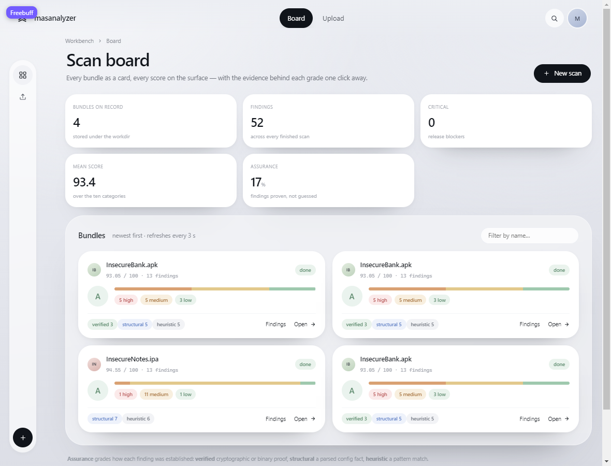<br>**Board** — scans on record, grade ring, severity bar, assurance tiers, fix-first door per case | 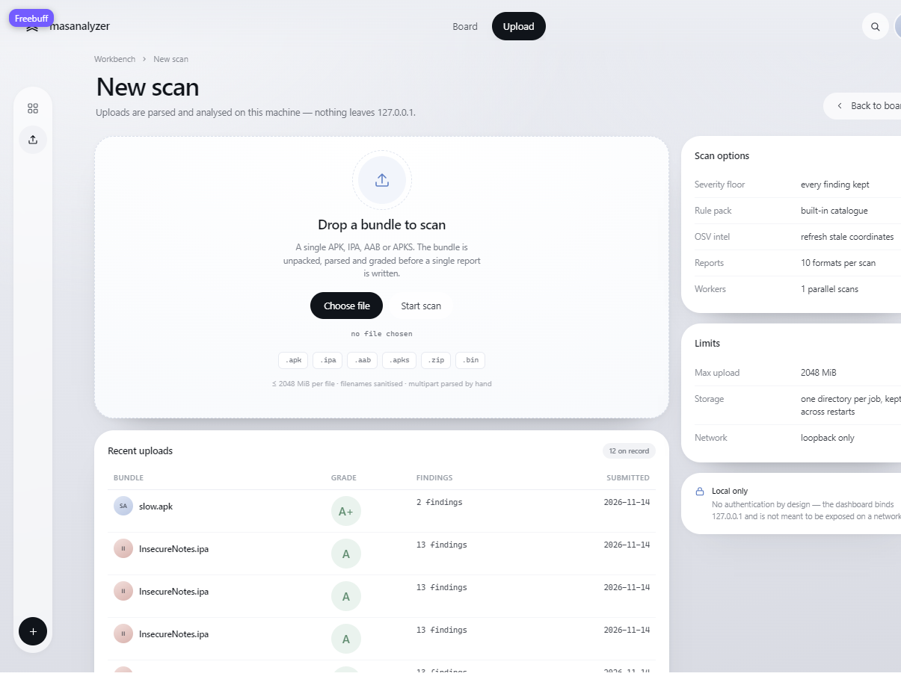<br>**Upload** — drag a bundle, live scan ledger (unpack → analyze → report) |
| 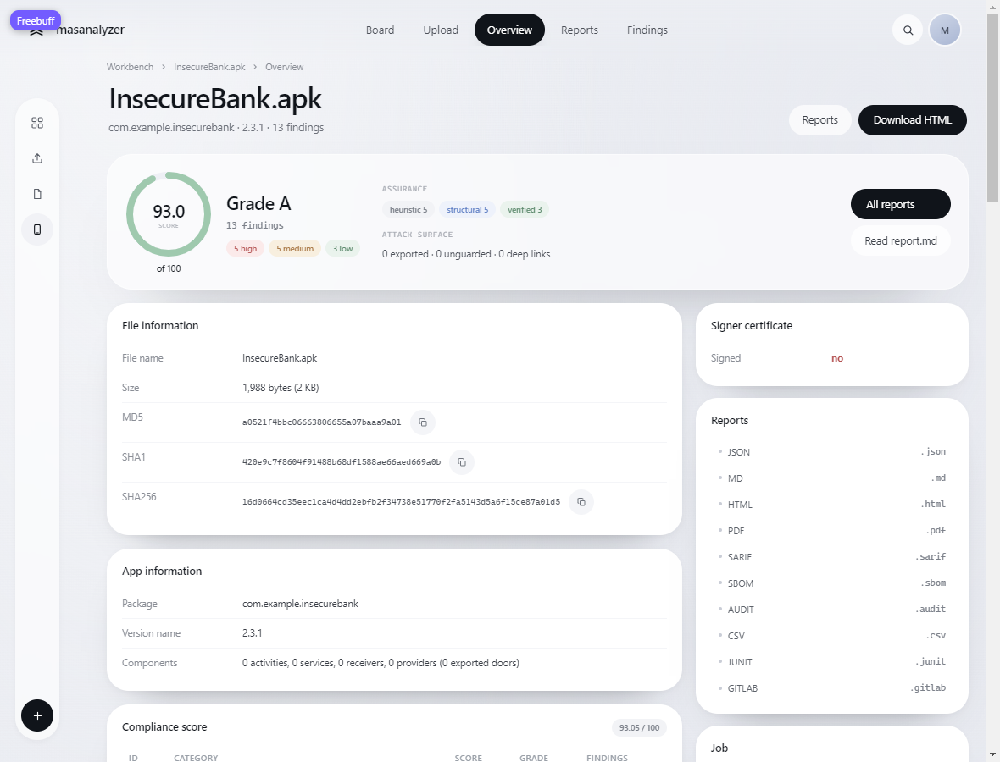<br>**Overview** — MobSF-style front page: hashes, app identity, scorecard, permission levels, attack surface | 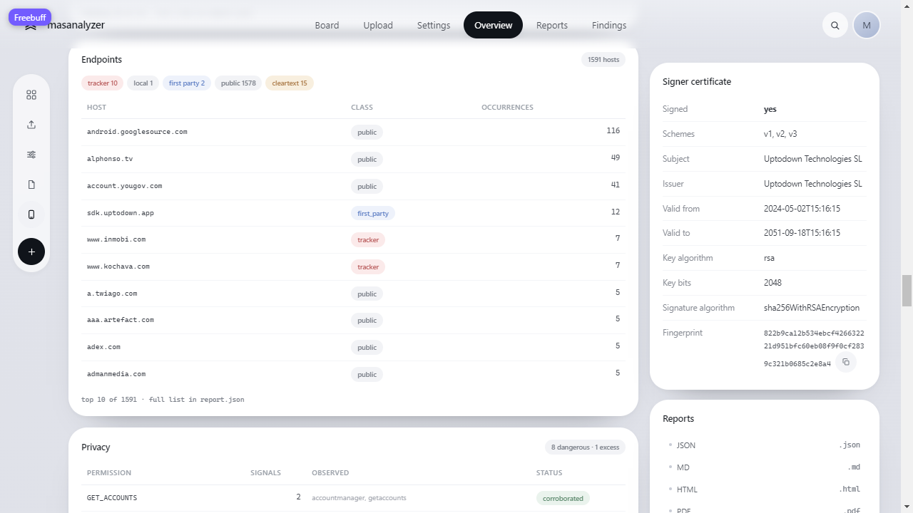<br>**Endpoints** — every host classified (tracker / first-party / local / public) with call counts |
| 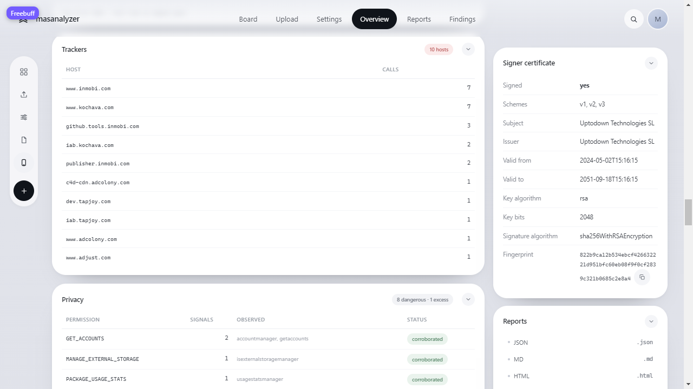<br>**Trackers** — the tracker hosts actually referenced, not a vendor-list denominator | 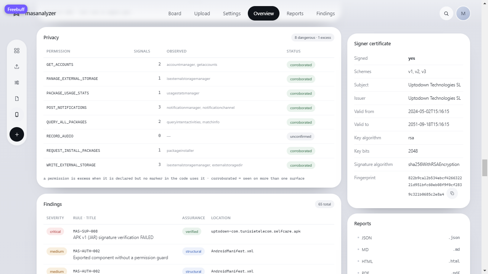<br>**Privacy** — declared permissions vs markers found in code, with corroboration |
| 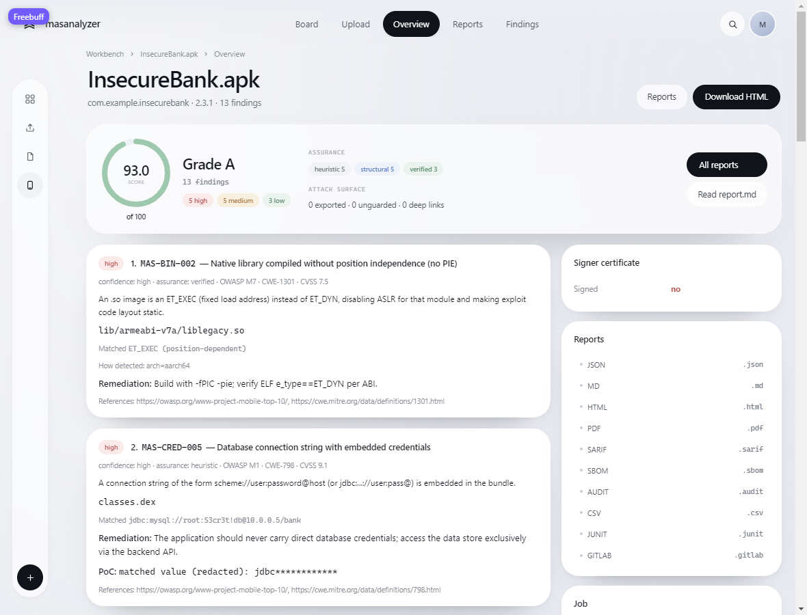<br>**Findings** — severity groups, assurance chips, collapsible cards | 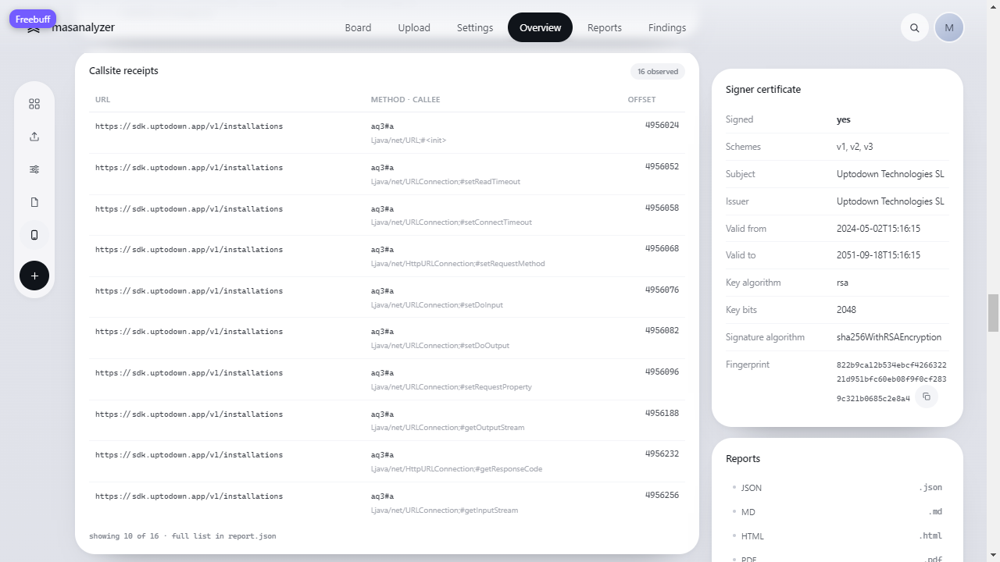<br>**Callsite receipts** — which method actually consumes each URL string |
| 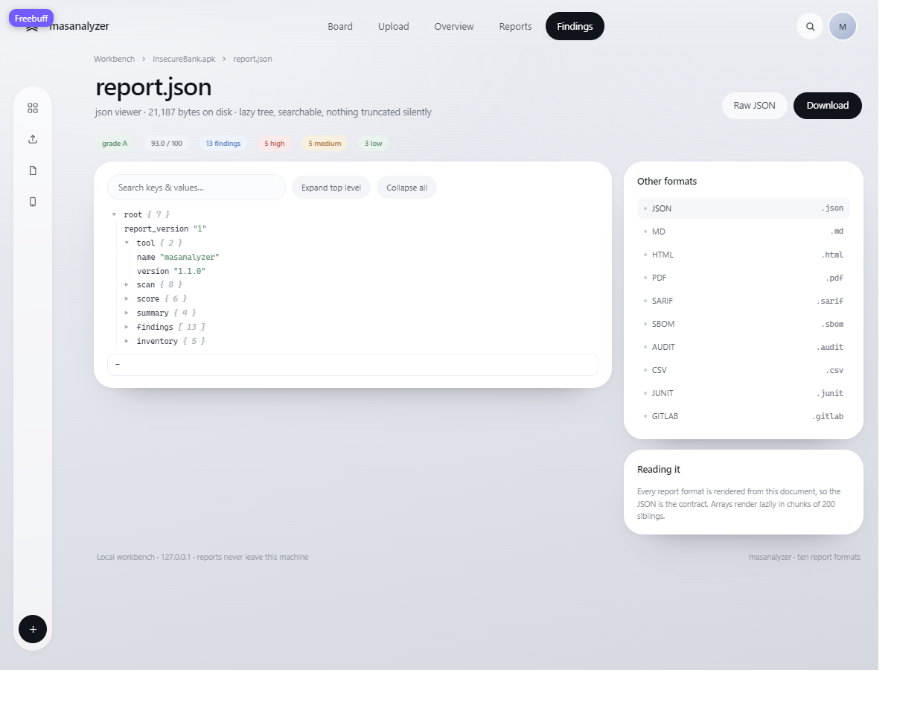<br>**JSON viewer** — searchable, collapsible tree | 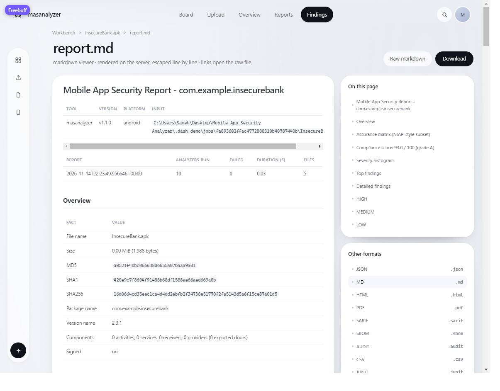<br>**Markdown viewer** — rendered report with sticky heading nav |
| 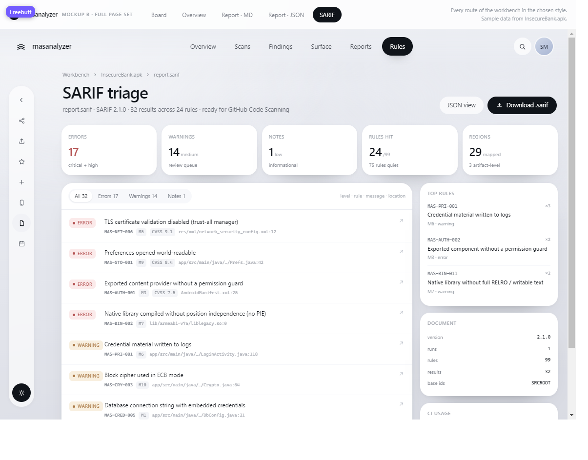<br>**SARIF triage** — level chips and per-rule reference cards | |

---

## Why masanalyzer (and not a Docker-based suite)

Fair comparison, stated factually: MobSF and similar suites are capable
tools, and masanalyzer deliberately does **not** imitate their
dynamic-analysis or external-service integrations. Where it overlaps,
here is what masanalyzer gives you that flat findings lists do not:

1. **Zero install friction.** `pip install` + run — no Docker image, no
   PostgreSQL, no bundled yara/APKiD/Jadx binaries. Everything, including
   AXML/DEX/ELF/Mach-O/X.509/APK-signature parsing and the dashboard, is
   the Python standard library. That makes it usable in
   compliance-restricted and CI environments where pulling a container is
   not allowed — and CVE data still stays current: scans auto-refresh
   stale OSV.dev coordinates for the SDKs they detect, degrading
   gracefully to the cached view when there is no network
   (`--no-intel-refresh` for strictly reproducible runs).
2. **Assurance tiers on every finding.** A `critical` result from
   signature-chain verification (`MAS-SUP-008`, tamper-proof) is not the
   same kind of claim as a `medium` from a string regex. masanalyzer
   grades each finding `verified` / `structural` / `heuristic`, so a
   release gate can block on verified findings and open review tickets
   for heuristic ones. Flat scanners report one undifferentiated list.
3. **Attack-surface synthesis with a fix-first queue.** The report opens
   with the reviewer's real question — *which doors can an attacker
   reach, and what do we already know about each one?* Exported
   components, their permission guards, browsable deep links and
   JS-bridge files are cross-referenced with the findings attached to
   each (by exact component-name evidence) — and ranked: every door
   gets a transparent exposure score (worst severity + 2 × verified
   findings + 1 if unguarded + min(deep links, 3)) so the report ends
   with a **Fix first** remediation order, not another unordered list.
   The delta gate watches the surface across releases too
   (`--gate-surface`): adding an unguarded entry point or a browsable
   deep link blocks the build.
4. **At-a-glance overview, parsed not scraped.** File hashes, app
   identity, signature schemes + signer certificate, permission
   protection levels and component counts on one panel (reports +
   dashboard `Overview` page) — including a real `resources.arsc`
   resolver so an `@res/0x…` app label becomes the actual string.
   Facts only: if the manifest does not declare something, the panel
   leaves it absent instead of guessing.
5. **Evidence hygiene as a contract.** Every finding carries a
   *Matched* symbol, a *How detected* note and the *exact* code line in
   all human formats; findings are deduplicated by content identity;
   JUnit case names are unique; reports are deterministic for identical
   inputs (CVE auto-refresh is the one deliberately time-varying layer —
   disable it with `--no-intel-refresh` when you need byte-reproducible
   runs). The suite tests this contract (489 tests).
6. **Conservative claims policy.** No invented CVEs: components without
   a mapped coordinate claim nothing; offline-unverifiable facts (e.g.
   Firebase security rules) say exactly that in the finding text.
7. **Ten report formats from one scan**, including a MASVS v2 audit
   matrix, SARIF 2.1.0, CycloneDX SBOM, GitLab/JUnit CI renderers and a
   deterministic PDF writer —
   plus a stdlib dashboard for upload-and-review workflows and a delta
   release gate that blocks version bumps with new high-severity
   findings, added permissions, changed signing identity or a grown
   attack surface.

8. **Both platforms, one tool.** Android (apk/apks/aab/source)
   and iOS (ipa/app tree/Mach-O) with the same rules engine, MASVS
   mapping and score.

If you need dynamic analysis, malware feeds or VirusTotal lookups, run
MobSF alongside — masanalyzer's static layer is designed to stand alone.

---

## Quick start

Clone and install (adds `masanalyzer`, `masanalyzer-diff`,
`masanalyzer-delta`, `masanalyzer-refresh-intel` and
`masanalyzer-dashboard` commands to your PATH):

```bat
git clone https://github.com/samehsbouri/masanalyzer-.git
cd masanalyzer-
pip install -e .
masanalyzer --version
```

There is nothing else to install: no Docker image, no PostgreSQL, no
bundled jadx/APKiD/yara binaries — the parsers, the crypto verification
and the dashboard are the Python standard library.

Or run directly from the repo:

```bat
python -X utf8 -m masanalyzer <target> -o <outdir> [--format all] [--min-severity high]
```

Add the helper CLIs with the same install: `masanalyzer-diff`,
`masanalyzer-delta` (release gates), `masanalyzer-refresh-intel`
(OSV CVE cache) and `masanalyzer-dashboard` (local web UI, below).

Examples:

```bat
:: scan the Android sample, write report.json/.md/.html/.sarif to samples\out
masanalyzer samples\InsecureBank -o samples\out --format all

:: scan the iOS sample as an .ipa container
masanalyzer samples\InsecureNotes\build\outputs\InsecureNotes.ipa -o out

:: only critical+high findings, HTML + SARIF only
masanalyzer samples\InsecureBank --min-severity high --format html --format sarif
```

CLI options:

| Option | Meaning |
| --- | --- |
| `target` | `.apk` / `.ipa` / `.aab` / `.apks` / directory / `.so` / `.macho` file |
| `-o, --output DIR` | where reports are written (`report.<ext>` per format) |
| `--format {all,json,md,html,sarif,sbom,audit,csv,junit,gitlab}` | repeatable; `all` writes every format; `junit` (alias `xunit`) and `gitlab` (alias `codequality`) are CI renderers |
| `--min-severity {info,low,medium,high,critical}` | drop findings below the floor and re-score |
| `--config FILE` | JSON scan policy (exclusions, severity overrides — see below) |
| `--baseline FILE` | suppress findings whose identity is in the baseline |
| `--update-baseline FILE` | (re)write the baseline from this scan's kept findings |
| `--keep-workdir` | keep the temporary unpack work directory |
| `--fail-on {info,low,medium,high,critical}` | exit `1` when ≥1 kept finding reaches this severity (CI gate; reports still written) |
| `--verify-identity SHA256` | anti-repack gate: exit `1` unless a signing certificate matches this fingerprint (colon/space tolerant, comma-separated list accepted; exit `2` = no verifiable cert) |
| `--rules FILE` | user JSON rule pack (`CUSTOM-<PACK>-<ID>` findings), repeatable |
| `--intel FILE` | IOC intel file (domains/IPv4/md5/sha1/sha256 digests), repeatable |
| `--osv-cache FILE` | JSON OSV-dev CVE cache; advisory matches raise `MAS-SCA-003`. Stale coordinates of the detected SDKs are re-queried automatically (best-effort); `--no-intel-refresh` disables that |
| `--serve` | after the scan, serve the generated reports on `http://127.0.0.1:8080/` until Ctrl-C (`--serve-port` changes the port) |
| `--watch SECONDS` | re-scan the target every SECONDS and rewrite the reports (dev triage loop) |
| `--list-rules` | print the full rule catalog (id, severity, OWASP category, title) and exit |
| `-v / -q` | verbose / quiet console output |

Exit code is `0` for a successful scan (findings are data, not failures).

### Team workflows: config + baseline + diff

Pin a scan policy once (`.masanalyzer.json`) instead of code changes:

```json
{
  "exclude_rules":  ["MAS-NET-004"],
  "exclude_paths":  ["^test/", "^build/outputs/"],
  "rule_severity":  {"MAS-PRI-001": "low"},
  "min_severity":   "low"
}
```

```bat
:: first triage - capture today's accepted issues
masanalyzer app.apk --config .masanalyzer.json --update-baseline baseline.json

:: every later scan only shows NEW / changed violations
masanalyzer app.apk --config .masanalyzer.json --baseline baseline.json -o out

:: release gate: fail when a new severity >= high appeared since last build
masanalyzer-diff out\old\report.json out\new\report.json --fail-on high
```

`masanalyzer-diff` exits `1` when new findings at or above `--fail-on` exist
(default `high`), so it can gate CI directly.

`masanalyzer-delta` additionally diffs the bundle facts a release must not
silently change — and the **attack surface**:

```bat
:: fail when a dangerous permission, a new signing identity, OR an
:: unguarded entry point / browsable deep link appeared since last build
masanalyzer-delta out\old\report.json out\new\report.json ^
    --gate-permissions --gate-signers --gate-surface
```

Example output when a release quietly adds an exported, unguarded,
web-browsable activity:

```
surface :
    UNGUARDED ADDED   com.example.app.OpenActivity
    DEEP LINK ADDED   myapp://gate.example/open

result: BLOCKED - 1 unguarded entry point(s) added: com.example.app.OpenActivity; ...
```

### Python API

```python
from masanalyzer import scan

result = scan("InsecureBank.apk")
print(result.platform, result.score.grade)
for finding in result.findings:
    print(finding.rule_id, finding.severity.value, finding.evidence.location)
```

Rendering:

```python
from masanalyzer.reporting import render
html = render(result, "html")   # json | md | html | sarif | sbom | audit | csv (+ aliases)
audit_md = render(result, "masvs")   # requirement matrix, alias of "audit"
```

### Anti-repack identity gate + cert quality

```bat
:: CI: fail unless the bundle is signed by OUR release certificate
masanalyzer app.apk --verify-identity AA:BB:... ^ 
    --format json -o out\publish --fail-on critical || exit /b 1
```

The gate compares SHA-256 fingerprints of every parsed signing
certificate (v1 PKCS#7, v2/v3 signing block) against the expected value;
MAS-SUP-013 (expired / ≤90-day cert) and MAS-SUP-014 (RSA < 2048) are
reported as findings on every scan, no flag needed.

### Live triage: serve + watch

```bat
masanalyzer app.apk -o out\triage --format html --serve
:: browse http://127.0.0.1:8080/ ; Ctrl-C to stop

masanalyzer app.apk -o out\triage --format html,json --watch 10
:: re-scans every 10s while you rebuild the app
```

### Dashboard: upload, scan, browse, download (`masanalyzer/dashboard.py`)

A local web workbench that needs no CLI at all — drag a bundle onto the
page and the scan runs in the background:

```bat
masanalyzer-dashboard
:: or: python -X utf8 -m masanalyzer.dashboard
:: http://127.0.0.1:8080/  (Ctrl-C to stop)
```

* **Upload** `.apk` / `.ipa` / `.aab` / `.apks` via the file picker or
  drag-and-drop; multipart parsing is hand-rolled (`cgi` is gone in
  Python 3.13+), filenames are sanitised and uploads are size-capped
  (`--max-upload-mib`, default 2048).
* **Scan** runs on a small worker pool (`--workers`, default 2) with live
  phase updates (unpack → analyze → report) polled every 2 s.
* **Reports**: all ten formats are rendered to the job directory;
  `html` and `pdf` open inline, `json` / `md` / `sarif` open in styled
  viewers (`/view/<id>/<fmt>`) — a searchable collapsible JSON tree, a
  rendered Markdown page with sticky heading nav, and a SARIF triage
  table with level chips and per-rule reference cards — and every
  format is downloadable raw as an attachment. Each job keeps its
  reports on disk, so they survive a dashboard restart.
* **Interface**: dark OLED workbench (`#0f172a` slate, green = pass /
  verified, amber = attention, red/orange = severity) set in IBM Plex
  Sans with JetBrains Mono reserved for machine data. Left icon rail,
  upload deck with a live status ledger (scanning now / scans on record /
  worst grade / total findings), and case-file rows per job: grade letter,
  severity distribution bar, assurance counts, attack-surface line and
  quiet action links. Motion is reserved for meaning — the severity bar
  fills once on load, the overview grade sits in a conic ring that sweeps
  to the risk score — everything else moves only when you act. No
  external assets, no frameworks; every icon is inline SVG and the pages
  honour keyboard focus states and `prefers-reduced-motion`.

Everything is stdlib-only and binds to `127.0.0.1` by default — it is a
single-analyst workbench, not a network service (no authentication; do
not expose it). Jobs live under `<temp>/masan_dashboard/jobs/<id>/`
(`--workdir` relocates them), with `job.json` per job for restart-safe
metadata.

```bat
masanalyzer-dashboard --port 8877 --workers 4 --workdir D:\masan_jobs
```

### MASVS audit matrix

`--format audit` (aliases `masvs` / `matrix`, file `report.audit.md`)
turns the scan into a requirement-level report: each of the 17 mapped
MASVS v2 requirements is PASS, FAIL (worst severity of the findings that
map to it) or N/A. Glosses are abbreviated self-authored summaries — read
the OWASP MASVS itself for normative wording.

---

## What it detects (OWASP Mobile Top 10 2024)

| Cat. | Category | Example checks (module) |
| --- | --- | --- |
| M1 | Improper Credential Usage | hardcoded passwords/API keys/JWTs/JDBC URLs (`m01`) |
| M2 | Inadequate Supply Chain Security | unsigned/debug-signed bundles, legacy v1-only signing, v1/v2/v3 cryptographic signature verification, Janus/CVE-2017-13156 ZIP-layout tampering, signing-cert quality (expiry, weak keys), v4 `.idsig` sidecar consistency, stale dependencies (`m02`, `android/apksigv2.py`, `android/apksigv4.py`) |
| M3 | Insecure Authentication/Authorization | exported unprotected components/providers, deep links, sharedUserId (`m03`) |
| M4 | Insufficient Input/Output Validation | SQL string concatenation, exec(), unvalidated file paths, WebView loadUrl (`m04`) |
| M5 | Insecure Communication | cleartext flags/NSC, user-rated trust anchors, no pin-set, HTTP endpoints, trust-all TLS, iOS ATS, third-party tracker + internal-address endpoints from the URL inventory (`m05`, `endpoints.py`) |
| M6 | Inadequate Privacy Controls | PII/credentials in logs or stdout, PII in plists (`m06`) |
| M7 | Insufficient Binary Protections | debuggable builds, non-PIE / executable-stack images, full-RELRO/TEXTREL analysis of `.so` ELF headers, `DT_NEEDED` dependency graph + missing-provider + dangerous-import checks (dlopen/mprotect/ptrace/exec), iOS CodeDirectory page-hash verification, unstripped symbols, unobfuscated DEX (`m07`, `packaging.py`, `elfdeps.py`, `ios/codesign.py`) |
| M8 | Security Misconfiguration | allowBackup without rules, testOnly, signature-permission requests, weak WebView (`m08`) |
| M9 | Insecure Data Storage | MODE_WORLD_READABLE, external-storage dumps, plaintext DBs, secrets in plists (`m09`) |
| M10 | Insufficient Cryptography | MD5/SHA-1, DES/RC4, ECB, default ciphers, weak PRNG, static IVs (`m10`) |

Rule ids use `MAS-<AREA>-<NNN>`; the full catalog lives in
[`docs/rules.md`](docs/rules.md).

### Compliance score (`reporting/score.py`)

Each covered category starts at **100** and is deducted by finding severity
(critical 25, high 18, medium 12, low 5 — weighted, capped at 100). The total
is the mean over the in-scope categories (M1–M10 with an analyzer that ran),
mapped to grades **A+ (≥97) / A (≥90) / B (≥80) / C (≥68) / D (≥55) / F**.

---

## Architecture

```
masanalyzer/
├── android/      AXML, DEX (+ callsite-receipt bytecode walker), APK signing +
│                 real v1/v2/v3 crypto verification (pkcs7.py DER/CMS parser incl.
│                 X.509 cert facts, apkverify.py JAR chain, apksigv2.py signing
│                 block, apksigv4.py .idsig sidecar)
├── ios/          binary plist, Mach-O, IPA/provisioning parsers,
│                 codesign.py (SuperBlob / CodeDirectory page-hash verifier)
├── packaging.py  classify → unpack → enrich → Target (APK/IPA/.aab/.apks,
│                 ELF RELRO flags, DT_NEEDED dep graph, shared string pool;
│                 thread-pooled hashing)
├── endpoints.py  URL/domain/IP inventory: tracker, private/internal, first-party
│                 classification + callsite receipt `called_from` attachment
├── elfdeps.py    DT_NEEDED parser + dangerous-import byte scan
├── masvs.py      MASVS v2 requirement matrix (PASS/FAIL/N-A) from findings
├── sdks.py       SDK fingerprinting + SCA vulnerable-version/EOL tables
├── osv.py        OSV.dev query/trim/cache layer (keyless, stdlib urllib)
├── intelcli.py   masanalyzer-refresh-intel: OSV CVE cache refresher
├── rulepack.py / iocs.py   user rule packs (CUSTOM-*) + IOC intel bundles
├── analysis/     registry + one analyzer per OWASP category (m01..m10) +
│                 taint.py (light intra-procedural taint tracking) +
│                 privacy.py (excess-access permission matrix)
├── reporting/    json / md / html / sarif / sbom (CycloneDX 1.5) / audit /
│                 csv / junit / gitlab code-quality renderers + score
├── config.py / baseline.py / diffcli.py / deltacli.py
│                 scan policy, baselines, diff CLI, release gate
├── watchserver.py  --serve local report server + --watch re-scan loop
├── testing/      synthetic fixture builders incl. real signature, .idsig,
│                 .apks/.aab containers and bytecode-bearing DEX fixtures
├── model.py      Finding / Evidence / Rule / ScanFile / Target
└── cli.py        argparse entry point (masanalyzer / python -m masanalyzer)
```

`scan()` runs the pipeline: **classify → unpack (zip containers) → parse
binary layers → run analyzers → score → render**. Every parser is defensive:
a corrupt member becomes a warning in `target.meta["warnings"]`, never a
scanner abort. Details in [`docs/architecture.md`](docs/architecture.md).

### Real v1 (JAR) signature verification

For Android bundles the v1 signature is not just detected — it is fully
verified the way the package manager would (`android/apkverify.py`):

1. the PKCS#7 blob must be cryptographically valid over the `.SF` bytes
   (`android/pkcs7.py` — a hand-rolled stdlib-only DER/CMS parser with real
   RSA PKCS#1 v1.5 and ECDSA P-256 verify cores),
2. the `.SF`'s `SHA-256-Digest-Manifest` must digest `MANIFEST.MF`,
3. every manifested entry must still match its signed digest — a repacked
   `classes.dex` fails here,
4. every archive entry must be covered by the manifest — injected files
   fail here.

A failed chain raises **MAS-SUP-008 (critical)**; both report and HTML
include the failing step. The `testing/` package builds real signed APK
fixtures for this (deterministic keygen + self-signed cert + PKCS#7).

### Real v2/v3 (whole-file) signature verification

`android/apksigv2.py` locates the APK Signing Block, parses the v2/v3 value
(signers → signed data → digests/certificates → signatures → public key), and
verifies it against the file like apksig would:

* content digest of the entry / central-directory / EOCD sections
  (1 MB chunked `SHA-256(0xa5‖len‖chunk)` + top `SHA-256(0x5a‖count‖…)`),
  EOCD CD-offset patched to the block start for the hash;
* RSA PKCS#1 v1.5 SHA-256 (0x0103) and ECDSA NIST-P256 SHA-256 (0x0201)
  signature verification with the stdlib-only cores from `pkcs7.py`;
* catalog equality (digest algorithms == signature algorithms), certificate
  ↔ SPKI match, min/max SDK plausibility (v3).

Load results are tri-state (`v2_verified`/`v3_verified` = None/True/False with
human-readable reasons). Failures raise **MAS-SUP-010 / MAS-SUP-011
(critical)**, and the rollback check (`.SF` must carry
`X-Android-APK-Signed: 2`) raises **MAS-SUP-012**. ZIP-layout anomalies feed
the Janus rule **MAS-SUP-009 (CVE-2017-13156)**. `testing/` builds real
v2/v3-signed APK fixtures via the same wire format.

### iOS code-signature verification

`ios/codesign.py` parses the SuperBlob at `LC_CODE_SIGNATURE` and verifies the
CodeDirectory: page-wise SHA-256 hashes over the executable record (negative
special slots are skipped — Apple's slot ordering is unstable across versions
and survey code avoids false positives). It also cross-checks the CMS slot's
`messageDigest` against SHA-256 of the CodeDirectory where the DER shape is
decodable. A failing page hash raises **MAS-BIN-012 (high)**; a Mach-O with
no signature block at all is MB2-flagged as unsigned.

### CycloneDX SBOM

`--format sbom` (aliases `cdx`/`cyclonedx`, file `report.cdx.json`) emits a
CycloneDX 1.5 inventory: the application component, native libraries with
their hardening flags, embedded APKs, linked dylibs, Maven-style
`group:artifact:version` dependencies harvested from resource files, and a
`vulnerabilities` array holding every finding (id, OWASP mapping, rating,
description). The serial number is a deterministic uuid5 of the target
identity, and keys are sorted — renders are reproducible.

---

## Keeping component CVE data current (OSV cache, auto-refresh)

SDK findings do not have to age: component advisories come from the
**keyless public OSV.dev database** — one POST per known Maven/SwiftURL
coordinate for the SDKs actually inside your bundle.

```bat
:: seed/refresh the cache explicitly (fleet-wide, CI cron, pre-release)
masanalyzer-refresh-intel app.apk --cache .masan\osv.json

:: scans keep themselves current: stale coordinates of the detected SDKs
:: are re-queried automatically before the SCA rules run (best-effort,
:: 5 s timeout). Advisory matches become MAS-SCA-003 findings with the
:: OSV advisory id in the evidence note.
masanalyzer app.apk --osv-cache .masan\osv.json -o out --fail-on high

:: strictly reproducible / no-network runs:
masanalyzer app.apk --osv-cache .masan\osv.json --no-intel-refresh
```

* **Always current by default**: every scan refreshes the stale
  coordinates behind the SDKs it detects; offline machines simply keep
  their cached view (each failed coordinate is counted, warned about on
  stderr, and never aborts the scan). A refreshed cache is written back
  to disk, so the next scan starts warm.
* **Currency is visible, never silent**: the cache carries provenance
  (newest fetch, coordinate/advisory counts) that appears as an `intel`
  section in `report.json` and a CVE-data line in the Markdown report;
  the dashboard shows a `CVE <N>d` chip per job (amber when the data is
  7+ days old or partially stale).
* Conservative matching: a finding only appears when the observed SDK
  version is an enumerated affected version of the advisory or sits below
  the advisory's first fixed version.
* Extensible: add Android coordinates to the `MAVEN_COORDS` dict and iOS
  repository URLs to `IOS_POD_COORDS` in `masanalyzer/osv.py` (the
  `SwiftURL` ecosystem keys packages by git repository URL; closed-source
  SDKs without a public repo are detected but deliberately unmapped).
* The dashboard accepts the same `--osv-cache` flag, so uploaded bundles
  get the same auto-refreshed CVE matching.

## Tests

```bat
python -X utf8 -m pytest tests -q
```

The suite (489 tests) covers parsers, packaging (including `.apks` /
`.aab` containers and DEX bytecode fixtures), the analyzer registry and
rules, the renderers (including HTML XSS-escape guarantees, SARIF region
fidelity, JUnit/Code Quality output and SBOM determinism), the taint
pass, the privacy matrix, user rule packs, IOC intel, the OSV CVE-cache
layer on both platforms (Maven and Swift/SwiftURL coordinates, with a
stubbed fetcher — no network in tests), the delta gate (including the
attack-surface regression gate),
config/baseline/diff workflows, real v1 *and* v2/v3 APK signature
verification (valid, tampered, repacked, uncovered-entry cases), a
corruption/fuzz corpus asserting the never-abort contract, M7 hardening
(ELF RELRO cases, iOS CodeDirectory good/tampered), the report-hygiene
contract (no duplicate findings, every finding carries and prints its
matched code / component / detection basis), MobSF static-analysis
parity (packer/protector fingerprinting, WebView TLS-bypass/mixed
content/remote-debugging, RSA NoPadding, insecure deserialization,
unauthenticated local sockets, root-tooling references, Firebase
endpoints), the differentiator contracts (assurance tiers on every
finding and report format; attack-surface synthesis with deep links,
permission guards and finding cross-reference; the exposure-ranked
fix-first queue and its transparent score formula), and end-to-end
dashboard tests over real HTTP (upload →
scan → reports → downloads, error paths, multipart parsing and job
persistence) — plus end-to-end scans of both shipped samples.

## Sample fixtures (training only)

`samples/make_samples.py` deterministically rebuilds two deliberately
vulnerable fixtures:

* **InsecureBank** — Android tree: exported components, cleartext + user-CAs,
  trust-all TLS, SQL concatenation, world-readable prefs, ECB/DES/MD5,
  non-PIE + PIE `.so` pair, unsigned APK.
* **InsecureNotes** — iOS bundle: ATS opt-out, credentials in UserDefaults,
  dev provisioning profile (`get-task-allow`), DES/ECB Swift code, arm64e
  Mach-O with an unsealed symtab, plus the packaged `.ipa`.

They are synthetic, deterministic and harmless (placeholder hosts, fixture
"secrets" only) — see [`docs/samples.md`](docs/samples.md).

## Limitations

* Static analysis only: rules are heuristic regex over source/text plus
  structural metadata from the parsers, assisted by a light lexical taint
  pass — no full dataflow engine, no decompilation, no dynamic analysis.
  Callsite receipts track registers linearly, so control-flow merges can
  leave a stale pairing; treat called_from as an evidence pointer.
* `.aab` protobuf blocks (manifest, `resources.pb`) need bundletool to
  become AXML; masanalyzer scans the flattened bundle tree and flags the
  unparsed blocks instead of guessing. `config splits` of an `.apks`
  APK-Set are merged as file-tree entries only.
* OSV coverage follows the `MAVEN_COORDS` / `IOS_POD_COORDS` mappings:
  SDK hits without a mapped coordinate (or without a parsed version
  string) are inventoried but never vulnerable-matched. The OSV
  `SwiftURL` (Swift) advisory database is still young — queries succeed
  but may return no advisories today.
* Findings are ranked by indicative CVSS/confidence for triage, not formal
  risk assessment.
